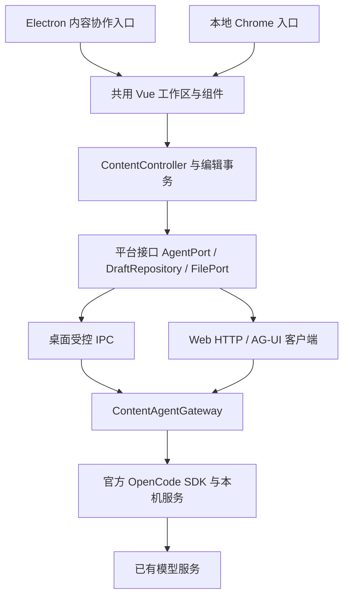

# Design

## Context

**结论：有条件采用 OpenCode 作为现成执行服务；一期主要建设 Vue 内容协作前端和组件库，AG-UI 只做交互协议适配。** 本文是设计提案，接入实验已执行，产品尚未实现。动机与范围见 [proposal](./proposal.md)，实验事实见 [接入验证](./evidence/integration.md)，快速阅读见 [飞书方案摘要](https://pcn11w88fq9h.feishu.cn/wiki/YNVXwcj0Vij6hhk2u57csEGXnMf)。

2026-10-25 核验 Xier `07dd6be`：Electron 45、Vue 3.5、TypeScript、Pinia、Dexie，主入口 `renderer/index.ts` 使用 memory router；`preload.ts` 暴露 IPC；聊天存储在 `renderer/dataBase.ts` 按账号切库，现有 schema v6。Xier 没有内容编辑器，也没有依赖 xier-element。

组件库仓库 `xiersiki/xier-element` 的 `master@3c3b090` 使用 pnpm workspace、Vue 3.4 peer、Vite 5、Vitest、VitePress/Storybook，已有 Button、Alert、Tag、Collapse、Loading 等 11 类导出。`packages/core` 提供 ESM/UMD、类型与样式，根入口注册 FontAwesome 全量图标。不能声称两项目已经集成，也不宜直接全量替换 Xier 当前 Naive UI。

## Goals / Non-Goals

**Goals:** 将编辑事务、异步建议、平台能力、Agent 协议分开，构建桌面与本地 Chrome 共用的一套内容协作功能；用实际可演示的错误恢复、键盘操作、组件消费端验证体现前端工程能力。

**Non-Goals:** 不引入 Agent 执行循环、工具调度、RAG 或模型评测框架；不为追新迁移 React/Next.js，不把新业务塞进聊天消息模型，不为 RN 同时维护第二套页面。外置 OpenCode 的本机权限配置不是 OS 沙箱。

## Decisions

### 1. 延续 Vue，新增功能模块和一个轻量 Web 入口



拟新增目录：

| 位置 | 职责 | 禁止依赖 |
| --- | --- | --- |
| `renderer/features/content/` | 工作区、编辑器包装、controller/composables、Pinia 元数据 | 不直接访问 Electron/模型凭据 |
| `common/content/` | 请求/建议/状态类型、运行时校验、纯状态转换 | 不依赖 Vue、Node 或 DOM |
| `renderer/platform/` | Desktop/Web AgentPort、文件导入导出、仓储注入 | 不包含业务 UI |
| `main/content/` | 桌面 IPC 注册、受控配置读取、服务生命周期 | 不修改聊天 provider 实现 |
| `services/content-gateway/` | OpenCode SDK adapter、AG-UI 转换、请求登记和取消 | 不做 Agent 推理循环 |
| `web/content/` | Vite 浏览器入口与 Node host，复用功能模块 | 不启动原 Electron AppInitializer |

桌面在现有 router 增加内容入口；Web 单独 bootstrap/router，避免整个现有 App 的 `window.api`、日志、认证初始化带入浏览器。平台能力通过 provide/inject 或构造参数注入，组件不用到处判断 `window.api` 是否存在。浏览器一期为独立本地访客工作区，不复制桌面登录体系，不宣称两端共享草稿或登录。

一个 gateway host 管理一个运行工作区，可由 Electron main 承载，或由本地 Web 的 Node host 承载。两种启动方式复用 gateway 模块。桌面 Web 演示连接同一 host 时共用并发锁；独立 host 需独立 profile，不能无锁共写同一 OpenCode 数据目录。host 层占用 profile 锁，重复启动显示已占用。

### 2. 编辑器使用 CodeMirror 6，正文以编辑事务为唯一入口

选择 CodeMirror 而不是富文本编辑器：一期处理 TXT/Markdown 源码，需要连续选区、可组合 transaction 与 undo；无需引入富文档模型。`@codemirror/commands` 的 history/undo 与 `isolateHistory` 用来把接受建议隔离成一个撤销步骤。锁版本在实现切片完成，不能将未安装的版本写成已测。

- `EditorView` 用 `shallowRef/markRaw` 管理并在卸载时销毁；CodeMirror EditorState 持有活动正文、选区、历史，Pinia 只持有草稿元数据、运行和建议投影，避免两套正文相互 watch 回写。
- 每个正文 transaction 增加单调 `revision`，包括 undo；光标移动不增加。导入统一换行为 LF。PRD 字数按 Unicode 码点计，编辑器范围按 UTF-16 offset 计，校验不切断 surrogate pair；不把“字符数”直接当 offset。
- 提交时冻结 `{scopeId,draftId,baseRevision,from,to,selectedText}`；模型只接收 selectedText 和 requirement，不需要整份草稿和本地 offset。
- 接受前同步校验归属、revision、原区间文本、结果长度与 suggestion 状态；通过后立即将状态转为 applying，再 dispatch 一次替换 transaction，最后设为 applied。重复点击即使组件节流失效也不能二次替换。
- 使用 history isolation 隔离接受前后的手工输入；拒绝、复制不 dispatch 正文 transaction。任何正文编辑使旧建议过期，之后 undo 回原文也不能恢复旧建议为可接受。
- Diff 用受控纯文本 before/after 呈现，第一期整段接受；对 4,000 字选区与最长候选设计算预算，超预算退化为并排文本而非卡住编辑。纯文本/转义渲染，不执行模型 HTML/脚本。

不建议先上 CRDT、自动三方合并、富文本或逐 hunk 应用；这些不会帮助第一期尽快证明正确性。

### 3. 状态分层，保存与恢复不依赖 Agent 历史

核心契约建议：

```ts
type RunStatus = 'connecting' | 'running' | 'cancelling'
  | 'completed' | 'failed' | 'cancelled' | 'unknown';
type SuggestionStatus = 'pending' | 'reviewable' | 'stale'
  | 'applying' | 'applied' | 'rejected';
type SelectionSnapshot = {
  scopeId: string; draftId: string; baseRevision: number;
  from: number; to: number; selectedText: string;
};
type RewriteResult = { replacement: string; explanation?: string };
```

运行完成不代表建议可应用：文档已变化时 run 可以 completed，但 suggestion 必须 stale。纯 reducer 处理状态迁移，Vue composable 绑定订阅/取消/卸载；Pinia 不承担编辑器历史。

新建独立 Dexie 数据库 `xier-content-<scope>`，含 drafts、suggestions，避免改动已有聊天 v6 schema 与云同步。桌面 scope 沿用现有账号/访客归属；浏览器本地访客 scope 独立。模型 key 不入这两个表。

保存采用约 300 ms debounce 和每草稿串行写队列，保存 draft 的 revision 与正文；接受带来的正文和建议处置状态在同一 IndexedDB transaction 提交。界面只有已提交版本等于当前版本时才显示已保存。失败保留内存正文并提供复制/导出，不在 finally 中伪报成功。关闭前尝试 flush，但不以 unload 承诺写入必成功；重启恢复最后确认快照。

建议记录包含原选区、baseRevision、结果、处置状态、requestId；进行中请求重开为 unknown，不自动生成。切换账号先撤销订阅/请求并隔离旧 scope 的回调；失败或迟到响应不能进入新账号投影。浏览器同一草稿多标签只允许单写者，使用 Web Locks + BroadcastChannel 通知；失败或不支持时第二标签只读，不实现并发合并。

### 4. OpenCode 接入是受控适配层

实测组合：OpenCode/SDK **1.19.4**、DeepSeek **deepseek-flash**、非思考模式。每次改写新建 session，使用 `@opencode-ai/sdk/v2` 的 flat 参数接口。

配置要点（不是完整用户配置）：

```json
{
  "permission": { "*": "deny", "StructuredOutput": "allow" },
  "agent": {
    "content": {
      "mode": "primary",
      "permission": { "*": "deny", "StructuredOutput": "allow" }
    }
  }
}
```

模型配置中 `options.thinking.type = "disabled"`。这来自真实失败：DeepSeek 思考模式拒绝 OpenCode 结构化返回所使用的 required tool choice；不是所有模型均如此。切换模型必须重做能力探测，不静默改模型或放宽工具。

每个 profile 使用独立 XDG 配置/缓存/数据目录、空工作目录，禁用项目配置、Claude 指令/skills、外部 skills 和默认插件等隐式加载来源；公开生产实现不能依赖测试专用 `OPENCODE_TEST_HOME`。启动前核验白名单配置，禁用自定义 plugins/MCP/instructions，集成测试检查实际发给模型的工具仅 StructuredOutput。这是应用权限约束，不能当作操作系统隔离证明。

默认连接外置固定版本 OpenCode，提供缺失、版本不兼容、鉴权失败的状态提示。不会把二进制随 Electron 打包或自动更新列为已验证；后续如做随包分发，需要额外验证签名、arm64 路径和退出清理。只关闭本应用启动的进程，不终止用户自行启动的服务。

真实配置由 host 读取现有 Xier provider，首次明确选择并验证 host/model；前端只取不含 key 的展示信息。实验用 loopback 转发代理将 key 留在探针进程内；代理仅用于验证，不据此要求产品新增一层模型代理。

**1.19.4 的已知兼容限制：** `session.messages()` 完整历史在包含 json_schema 用户消息时出现 `OutputFormatJsonSchema` 解码错误；本次已测 `session.message(messageID)` 与 `session.messages(limit:1)` 可回读助手结构化结果。gateway 保存 sessionID/assistantMessageID 映射，优先按 ID 读取；没有 ID 时只查询最新消息并核验 role、session、完成时间、schema。无结果或无法可靠判断即 unknown，不修内核，不扫描历史猜测。

### 5. AG-UI 负责统一前端接收的运行事件

OpenCode 提供自己的 HTTP/SSE 与 SDK，本次没有核验到可直接替代适配层的原生 AG-UI 服务。gateway 负责转换；AG-UI 不负责模型调用、编辑器正文、持久化、鉴权或 Agent 内核。

| 来源/事实 | 输出到前端 | 前端作用 |
| --- | --- | --- |
| gateway 接受并登记 request | RUN_STARTED | 显示生成中，关联 requestId |
| 实际文本 part 增量（如有） | TEXT_MESSAGE_START/CONTENT/END | 只读预览，不允许接受 |
| 最终 structured 校验通过 | STATE_SNAPSHOT，限定 proposal/result 状态 | 建立候选建议，计算 diff |
| 完整成功 | RUN_FINISHED | run 完成，继续做本地版本检查 |
| 服务错误/非法结果 | RUN_ERROR + 明确 code | 错误和可重试提示 |
| 取消已确认 | RUN_ERROR，应用约定 code=CANCELLED | 映射为 cancelled，而非普通报错 |

上述 CANCELLED 是应用错误码约定，不宣称存在标准 RUN_CANCELLED 事件。普通文本通过 `(sessionID,messageID,partID)` 归属；快照与 delta 不重复拼接。最终状态只接受一次，迟到事件不能覆盖终态。第一期不用 STATE_DELTA 修改正文、不实现工具调用 UI、动态生成组件或 CopilotKit React 依赖。

本次结构化请求返回 tool part，没有可展示 text part；因此只需要 RUN_STARTED → STATE_SNAPSHOT → RUN_FINISHED。`@ag-ui/encoder` 与 `@ag-ui/client` **1.0.3** 已用这条事件链实测（真实结果经最小桥接回放），不是完整生产集成。

Web 端 `HttpAgent` 负责 SSE 解码，Vue composable 订阅并驱动共用 reducer。桌面 AgentPort 可经 IPC 转发相同的类型化 AG-UI 事件，不要求为 Electron 强行绕一次浏览器 HTTP。两个 transport 共享契约测试。

### 6. 取消、幂等和断线需要明确 API，协议不会自动解决

建议 Web 接口：

| 接口 | 入参/返回 | 关键行为 |
| --- | --- | --- |
| POST `/api/content/agent` | AG-UI RunAgentInput；forwardedProps 带本次选区和要求 | SSE；threadId=本地草稿映射，runId=唯一 requestId；不透传历史 messages/state/tools |
| GET `/api/content/runs/:requestId` | 运行状态、经校验结果或 unknown | 核实原请求，不触发生成 |
| POST `/api/content/runs/:requestId/cancel` | 请求取消后返回 observed status | 调用 OpenCode session.abort 后核实 |
| GET `/api/content/health` | 状态、版本、脱敏模型能力 | 不暴露配置或 key |

gateway 只接受 schema 白名单；忽略/拒绝客户端提供的任意 OpenCode sessionID、目录和工具配置。服务维护唯一 requestId 与输入摘要，重复 runId 不新开模型请求；同 ID 不同内容返回冲突。跨窗口并发锁放 host，不仅靠按钮 disabled。记录丢失或 host 重启不支持隐式恢复运行，前端按 unknown 处理。

**`HttpAgent.abortRun()` 只中止客户端 HTTP 请求。** 点击停止先进入 cancelling、调用 cancel 接口，核实服务端已停止后才 cancelled；最后释放流订阅。abort 返回成功但已生成完成时重新读取结果，以真实完成状态为准。连接断开进入 unknown，恢复时 GET 状态；不要重新 POST runAgent 当成“重连”。

本地 Web 由 Node host 同源提供静态页和上述 API，只监听 loopback，验证 Host/Origin、建立本机启动的会话凭据，拒绝跨站请求；OpenCode 管理密码留在 host。Electron IPC 核验 sender/window、参数长度和 run 归属，订阅返回 unsubscribe。不能把完整 OpenCode API 作为浏览器通用反向代理。

### 7. 组件库复用采用增量包，不全站替换

在 xier-element 的现有 workspace 新增 **`packages/ai-ui`**（包名暂定 `@xier-element/ai-ui`，发布权限实现时核验），保持原 xier-element 1.x 导出不变。新包只依赖 Vue peer、必要基础组件与 CSS token，不引入 Pinia、OpenCode、AG-UI runtime、Electron 或文件系统。

| 组件 | props | emits / slots |
| --- | --- | --- |
| ContextSelection | selectedText、count、limit、disabledReason | submit(requirement)、cancel；操作扩展 slot |
| RewriteSuggestion | before、after、explanation、status、canAccept | accept、reject、copy；diff 展示 slot |
| GenerationStatus | status、errorMessage、elapsedMs、canCancel | cancel、retry；状态图标 slot |

组件只表达用户意图；Xier controller 执行模型请求、CAS、编辑 transaction 与保存。接受正确性不能依赖现有 Button 的默认 500 ms throttle。复用 Button、Alert、Tag、Loading 及主题变量，补齐键盘/aria 状态示例；CodeMirror wrapper 留在 Xier，暂不包装成通用富编辑器。

先用纯 fixture 将三类组件跑通并在现有 VitePress/Storybook 展示，再 `pnpm pack` 产出 tarball 让 Xier 独立安装验证，最后发布版本并锁入 npm lockfile。检查 ESM/类型/CSS exports、Vue external、无重复 Vue、样式作用域及图标体积；当前 core 根入口有全量图标注册，须测产物后选择精简入口或让 ai-ui 提供 icon slot，不盲目引入全库。

库自身仍按 Vue >=3.4 的兼容目标验证，Xier 使用其实际 3.5 版本验证；不能只因 peer range 满足就声称集成完成。未来 RN 复用纯 TS 契约、状态 reducer、测试样例和设计 token；Vue DOM 组件不能直接复用为 RN 原生组件。

### 8. 验证边界与开发顺序

公开测试边界：用户可见编辑/状态/按钮行为、DraftRepository 持久化契约、AgentPort transport 契约、gateway HTTP/IPC 契约、组件 props/emits。不要 mock 内部函数后断言函数互调来代替行为测试。

| 切片 | 可交付结果 | 依赖 |
| --- | --- | --- |
| A | 固定响应下的草稿编辑、选择、建议审阅、接受/撤销与冲突闭环 | 当前设计 |
| B | 三类组件独立演示，tarball 在 Xier 消费，闭环不退化 | A 交互契约 |
| C | 受限 OpenCode gateway、真实结果、AG-UI/IPC 契约、停止与核实 | 接入证据 + A |
| D | 草稿/建议持久化、账号隔离、错误恢复，多标签单写者 | A/C 数据契约 |
| E | 独立 Web 入口与桌面共用模块、同源服务、双端验收 | B/C/D |

每片执行 RED → 最小 GREEN → REFACTOR，逐片记录证据；细项见 tasks.md。个人业余开发粗估 12–18 个专注开发日（不含等待、签名发布和未知上游问题），不是承诺日期；不同时推进 RN、PWA 和桌面大重构。

固定响应覆盖 PRD 十类场景，Electron 和 Chrome 各 10/10；测试选择中文/emoji/换行、区间边界、重复事件、断线与完成/取消竞态。再做五次完整真实建议与应用，至少四次成功。本次两次有效真实改写没有 UI 接受步骤，不能计为这项已达标。

性能以 20k 正文和 4k 选区各取至少 30 次，记录选择/接受/撤销到下一次绘制的 p95；正常保存 20 次，另注入 quota/IO 失败。组件独立示例测键盘和可见状态。保留原对话、取消、账号隔离回归，打包检查单独记录；默认 CI 离线，不带真实凭据。

## Risks / Trade-offs

- OpenCode 偏编码且配置/接口变化快 → 锁定 1.19.4 验证基线，限制工具并维持契约测试；历史接口缺陷隔离在 adapter，不 fork 内核。
- 结构化返回依赖模型工具能力，可能没有正文流 → UI 支持仅状态的生成体验；错误显式失败，不把不完整结果强行解析成功。
- 取消确认不等于服务商停止计费 → 只承诺已观测的本机任务状态；不宣称账单取消。
- 编辑器历史与数据库是不同事务域 → 内存接受同步去重，正文和建议持久化原子提交，保存失败可见；崩溃仅恢复最后确认版本。
- 两端 IndexedDB 不共享 → 一期分别保存、分别验收；跨端同步另立需求。
- 跨仓库发布和旧打包配置带来消费差异 → 先 pack 消费再发布，小范围复用组件，不统一重写两仓构建工具。
- AG-UI 增加一层适配 → 控制在三类主要事件与显式状态查询，保留 AgentPort 使协议替换不影响编辑器；这层投入的价值是前端契约学习和后续接入替换。

## Migration Plan

先在独立功能入口接入，保留原聊天入口；新增内容数据库无需迁移聊天记录。组件库只增量发布，不改变原导出。开发与测试使用独立 profile，禁止读取真实聊天作为 fixture。

回退时关闭内容入口与 gateway，保留新数据库供后续恢复，原聊天仍可用；停止本应用拥有的 sidecar，撤销订阅。不要删除用户草稿或自动卸载用户安装的 OpenCode。只有产品全部任务和适用检查完成后才能同步主规格、归档及合并；当前仅方案稿。

## Sources

- [OpenCode SDK 与结构化输出](https://opencode.ai/docs/sdk/)、[服务与取消接口](https://opencode.ai/docs/server/)。SDK 文档与实测以 evidence 的版本和结果为准。
- [AG-UI HttpAgent](https://docs.ag-ui.com/sdk/js/client/http-agent)、[事件定义](https://docs.ag-ui.com/concepts/events)。事件 draft 扩展不纳入本期。
- [CodeMirror history 源码](https://github.com/codemirror/commands/blob/main/src/history.ts)，其旧 GitHub 分仓已归档，官方开发入口已迁移至 [新仓库](https://code.haverbeke.berlin/codemirror/dev)；实现时锁定当前 npm 包版本。
- [组件库核验提交](https://github.com/xiersiki/xier-element/tree/3c3b090254cf4a71c489278ed3cbc72244e452af)、[Xier 核验基线](https://github.com/xiersiki/xier/commit/07dd6be)。
