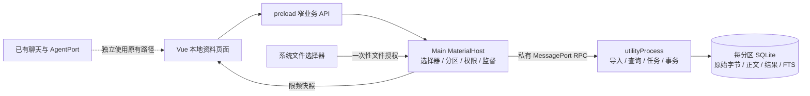
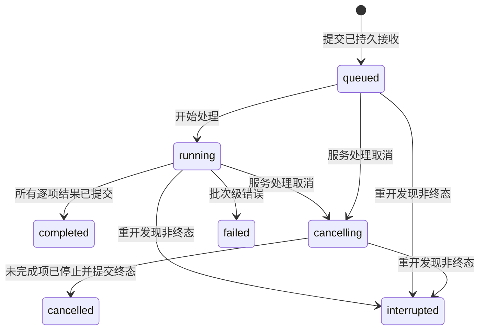

# Design

评审稿 v0.1 · 2026-10-26。建议在现有 Electron 应用中增加独立、按本地身份绑定的资料服务：主进程管理权限与生命周期，utilityProcess 处理导入和 SQLite，Vue 通过窄业务 API 查询结果。先验证实际安装包的存储、检索与取消预算，再开始产品实现。

[PRD](https://pcn11w88fq9h.feishu.cn/wiki/LMW1w1n5AiSIDBkeheac4WWQnij) · [技术方案](https://pcn11w88fq9h.feishu.cn/wiki/Hf02wtW5eiXhRfkUQDec9qCpnWe) · [Issue #28](https://github.com/xiersiki/xier/issues/28) · [版本化规格与任务](https://github.com/xiersiki/xier/tree/codex/local-material-design/openspec/changes/add-local-material-service)

产品范围见配套 PRD；版本化契约、设计与任务在 [Issue #28](https://github.com/xiersiki/xier/issues/28) 关联的 add-local-material-service 中维护。本篇为评审与学习视图，实施进度与证据只在 change/PR 更新。用户已选择方向，本方案中的具体参数与选型仍待评审和实验。

## Context

main 7c083d4 使用 Electron 45、Vue 3、TypeScript、Pinia、Dexie 和 Forge/Vite。WindowService 已有沙箱窗口与启动异常处理；DialogueService 在主进程处理模型流。preload 暴露有限 API，尚无资料进程；Forge 目前只有 main/preload entry，必须增加独立服务产物。现有聊天存储与同步不迁移。

auth.applySession 当前在 renderer 串行切换本地缓存，主进程没有当前账号绑定。本设计需要专用分区桥及 epoch，不能假定主进程已有可信账号上下文。PR #25 的内容编辑和 PR #27 的 OpenCode 接入均保持独立，当前还未完成一期交付。

## Goals / Non-Goals

Goals：资料服务故障不主动关闭 UI；提交、取消与重开结果一致；业务调用不能任意选择文件路径或身份分区；用实际 Electron 运行与故障实验检验预算。主验收为 macOS arm64。

Non-Goals：本期不构建通用任务调度器、Agent 循环、插件宿主、云同步或多窗口共享编辑；不借此替换旧 Dexie、统一移动存储或升级 Electron。非对抗性本地资料管理不承诺抵抗已攻陷 renderer、同 OS 用户或磁盘物理故障。

## Decisions

### 1. 进程及模块的职责



| 层次 | 责任 | 禁止承担的责任 |
| --- | --- | --- |
| Vue 功能模块 | 页面、焦点、查询序号、当前结果与进度 | 任意系统路径、数据库连接、全库正文常驻 |
| preload | 类型化业务方法、响应校验、返回 unsubscribe | 暴露 ipcRenderer、任意 channel 或 Electron event |
| MaterialHost | 来源检查、文件授权、分区绑定、启动/退出、超时 | 文本处理、搜索扫描、模型执行 |
| utility entry | 受限队列、文件读取、规范化、SQLite 和任务终态 | 自行请求云身份、操作窗口、自动调用 Agent |

备选是主进程直接执行，模块少但同步 SQL/文本计算会影响窗口职责；Web Worker 适合纯浏览器计算，但本模块需要 Node 文件能力和独立故障边界。选择 utilityProcess 的收益是职责与故障隔离，不提前断言更快或更省内存。首版 renderer 不持有原始 MessagePort；轻量命令/预览经窄 IPC，main 与 utility 之间使用私有 MessagePort，避免同时引入 renderer 端口握手。

建议目录：main/materials/{host,entry,protocol,repository,importer,search}.ts、common/materials/{contracts,validation}.ts、renderer/features/materials/{components,composables}。名称是模块边界草案，最终跟随仓库约定。

### 2. Vue 接入和与一期的边界

MaterialWorkspace 负责组合和业务状态；ImportPanel 接收选择摘要、job snapshot、禁用原因并发出 pick/start/cancel/retry；MaterialList 接收分页结果、活动 ID 和加载状态并发出 select/loadMore/remove；MaterialPreview 接收正文页和错误并发出 loadMore/copy。props/emits 以 TypeScript 声明，显示组件不直接访问 IPC。

useMaterialService 管理当前 lease、请求与订阅释放，useMaterialSearch 负责 debounce、取消旧查询和丢弃过期结果；Pinia 如需缓存只保留元数据。离开资料路由释放观察与预览缓存，导入继续；关闭应用由持久恢复规则处理。预览为纯文本，不复用可执行 Markdown/HTML 渲染。

导航新增「本地资料」；本期不让资料自动进入 Agent 上下文，也不把副本强接到一期草稿编辑器。未来连接编辑器时通过明确的导出/新建草稿接口，不能写另一套编辑器状态。路由、preload、auth 和 Forge 是与一期共享的文件，实施时先核对最新 diff 并指定单一写入者。

### 3. 分区绑定与文件授权

启动时 Host 为 unbound，等唯一主窗口现有认证控制器报告本地访客/账号状态后才创建 scope。专用 auth bridge 校验发送方为注册的主窗口主 frame，限制为已知应用 URL；账号键派生分区目录，renderer 不发送数据库路径。业务请求只携带 Host 生成的 lease/epoch，Host 逐次核对当前绑定与来源。

该桥沿用现有受信 renderer 认证假设，用于本机防误串、请求归属和迟到结果隔离，不是新的服务端身份验证，也不是对恶意 renderer 的账号访问控制。离线启动沿用现有会话恢复结果；恢复失败只按现有规则绑定访客，不猜测原账号。相同账号 token refresh 不换 epoch。

真切换先递增 epoch、禁用旧操作并清空旧视图，给旧批次发送取消；最多等待 5 s，未结束则终止旧服务。旧连接关闭后才绑定新分区。已进入提交的旧项允许完成在旧分区，永不复用旧服务写新库；迟到回包无论内容如何均不交新视图。新分区启动失败保持入口不可用，不回退借用旧库。

选择器由主进程打开；预检扩展名、数量及元数据，冻结 size/mtime/文件身份指纹，返回 selectionId 和安全显示信息，不返回完整路径。selectionId 绑定当前 lease、有效 10 分钟，首次 start 后只能映射到同一个 requestId；Host 的授权 manifest 作为内部消息分片传递，每片最多 32 KiB、总上限 4 MiB，编号/总数/摘要齐全后才持久接收，源路径只支持 macOS 本地选择器实际可返回的范围；取消选择不建任务。Host 只向私有服务发送授权源路径集合。服务用只读 fd 检查普通文件、实际读入字节上限，以及前后 fstat 的大小、时间和身份；打开 fd 时须先与冻结指纹核对，处理期间按实际字节再次限制单文件和批次剩余额度；变化或累计超限的项失败，不允许选择后稳定增长绕过 20 MiB。对检测到的变化返回 SOURCE_CHANGED。这是变化检测，不保证获得任意并发写场景的原子快照。

### 4. 存储选择与原子保存

优先实验 Electron 内置 node:sqlite：省去额外原生二进制，但 Electron 45 对应 Node 24.22.0 的该 API 仍标 Release candidate，开发机 Node 22 与 Electron runtime 不等同。备选固定版本 better-sqlite3 13.x 已采用 N-API，仍需验证目标架构、原生加载、ASAR 与分发；不能把旧版本的 V8 ABI 限制套到所有版本。二者都提供同步 SQL，会阻塞服务自身的 JS 消息循环。

只有 G0 实际 Electron 与打包验证通过才锁定依赖，不在本次文档中修改 lockfile。如果内置实现或预算不通过，记录结果选择备选；改变搜索语义、上限或取消预算必须回评审，不能当实现细节静默调整。

每分区一个独立数据库，路径由 Host 在 app.userData 下生成，访客/账号目录分离。资料服务是唯一 writer，使用 WAL、foreign_keys=ON、synchronous=FULL，拒绝扩展加载与调用方提供 SQL。磁盘和 OS 正常工作的前提下验证进程退出恢复，不宣称物理掉电零丢失。

| 实体 | 核心字段 | 不变量 |
| --- | --- | --- |
| documents | id、sha256、name、rawBytes BLOB、decodedText、searchTitle、searchBody、createdAt | sha256 分区内唯一；原始字节保留 BOM/换行，正文只用于显示 |
| jobs | jobId/requestId、inputDigest、status、revision、counts、retryOf、createdAt | requestId 唯一；同 ID 不同摘要冲突；终态不可改回运行 |
| job_items | jobId、ordinal、displayName、status、documentId、errorCode | 每项结果与资料提交一起落盘；源路径不持久化 |
| meta 与 FTS | schemaVersion、libraryRevision、quota、title/body 索引 | 配额在最终事务检查；索引为可重建派生数据 |

2 MiB 文本限制允许把当前文件原始字节、解码文本和索引写在同一个短事务中。事务内先检查 sha256 重复，再检查 500 份/100 MiB 配额，再插入 document/FTS、更新 job_item 和计数；若为最后一项（含duplicate或可持久记录的逐项failed），同时写 completed，最后 COMMIT；只有之后才发成功。相同内容不再次计额，移除也在同一事务更新资料、索引和配额。job_items 的历史结果不级联删除；保存当时documentId/name，指向已移除资料时显示「副本已移除」，不展示失效正文。该方案避免「文件 rename 成功而 DB 未提交」的跨资源补偿，但原字节、正文、索引会放大磁盘占用。

按每次读取最多 64 KiB 检查取消和尺寸，最多累计一个文件，禁止同时加载整批原始字节。TextDecoder fatal 验证 UTF-8，空/含 NUL 拒绝。哈希基于原始字节；显示正文与检索规范化文本分开。事务失败回滚；如果连失败记录也写不下，页面显示待核实，重开依据持久状态转中断，不能伪造持久失败记录。

### 5. 请求、快照与限流

API 是评审草案，运行时按允许的方法与字段校验，不能仅靠 TS 类型。Host 将 app 级 scope 与 serviceEpoch 注入服务端封套，renderer 不能覆盖。

```typescript
type MaterialApi = {
  chooseFiles(): Promise<SelectionSummary | null>;
  startImport(input: { requestId: string; selectionId: string; retryOf?: string }): Promise<JobSnapshot>;
  getImport(requestId: string): Promise<JobSnapshot | null>;
  listImports(input: { cursor?: string }): Promise<JobPage>;
  cancelImport(requestId: string): Promise<JobSnapshot>;
  observeImports(onSnapshot: (value: JobSnapshot) => void): () => void;
  search(input: { queryId: string; text: string; cursor?: string }): Promise<SearchPage>;
  cancelSearch(queryId: string): Promise<void>;
  readText(input: { documentId: string; offset: number }): Promise<TextPage>;
  copyText(documentId: string): Promise<void>;
  removeMaterial(documentId: string): Promise<void>;
  restartService(): Promise<ServiceSnapshot>;
};
```

listImports 在重开/重新绑定后按时间列出当前分区任务，每页最多 20 条，返回 requestId、状态和计数；页面据此发现活动/中断任务再 getImport，不依赖保留内存 ID。主窗口 clipboard 业务通过受控 Host 调用完成，全文复制在 Host 内进行，不把原始 BLOB 一次性送进 renderer。分段预览 offset 按 Unicode code points 定义，固定段上限 20,000；文件最大 2 MiB 使一次复制仍有上限。UI 返回 DTO 不携带来源路径或原始字节，单次 UI 响应最多 256 KiB。全文复制使用仅 Host 可发起的内部方法，正文传输上限 2 MiB UTF-8 字节；不受 20,000 字符预览段限制。

| 封套/结果 | 必要字段 | 语义 |
| --- | --- | --- |
| 请求 | protocolVersion、commandId、method、lease/epoch、payload | method/版本白名单；UI 请求及一般消息最大 64 KiB，拒绝未知字段与越界内容 |
| 响应 | commandId、ok、result 或 code/message | 超时不自动重发写命令；写结果用 requestId 查询 |
| 快照 | serviceEpoch、jobId、revision、status、counts、items | 仅接受当前 epoch、更新 revision；中间快照不是持久成功 |
| 错误 | code、可行动说明、requestId | 不包含密钥、正文、完整路径或底层 SQL |

Host 数据面允许最多 16 个在途命令，超出返回 BUSY；同分区最多一个导入批次，服务 RPC 命令队列最多 32 项（100个批次文件条目独立持久化，不计入RPC队列），用户侧不能无界排队。导入 progress 最多每秒 4 次发送最新快照；每观察者最多保留一个待发送中间快照。终态优先发送且永远可 getImport 回读。cancel、scope revoke、restart 和 liveness 走独立控制面，不占数据面配额，Host 最多4个控制在途且按job/操作合并重复控制；服务在每个可让出点先处理控制队列，不能因数据队列满而拒绝取消。控制优先级也不能抢占同步 SQL，仍需 G0 证明单次阻塞上限。MessagePort 本身不提供本方案的背压保证，上述限额与合并是应用层协议。

选区能力和 requestId 的重放只用于原输入；ACK 丢失时查询持久 requestId。页面销毁或导航仅解除观察；窗口销毁释放该窗口 RPC 和订阅，任务按应用关闭/身份切换规则处置。取消 observe 不等于 cancelImport。

### 6. 取消、提交与批次状态

批次状态为 queued、running、cancelling、completed、cancelled、failed、interrupted；逐项为 pending、reading、committing、imported、duplicate、failed、cancelled、interrupted。completed 代表所有项已处理，可能有逐项失败；页面用计数表达「完成，部分失败」。failed 用于批次级验证/存储故障；服务失联的 unknown 是观察状态，不伪写入持久任务表。



取消不是回滚已确认历史。服务在读块、处理文件、开始事务前检查取消；一旦开始同步事务，取消消息只能等待 SQL 返回后处理。因此 COMMIT 是当前资料是否完成的边界：提交先完成则保留当前项，再停剩余项；取消先被处理则不开始当前项提交；全批完成后取消返回 completed。cancelled 的持久确认发出后不得再提交该批次。

G0 必须测最坏单文件 FTS 写入及短词查询期间的取消/心跳延迟。分片和 yield 不能打断一条已经运行的同步 SQL。若单次 SQL 超预算，先缩小 SQL 工作量或调整索引设计；不得用「直接杀整个服务」冒充正常的单任务取消。只在服务无响应、退出或身份切换超时的故障路径终止进程。

### 7. 搜索和预览的准确性

检索规范化函数固定为 NFC → toLowerCase() → NFC；先 trim 查询，再以 Array.from 的 code points 检查 1–128。显示保留解码正文，UTF-8 BOM 不显示但保留在 rawBytes。标题与正文分别匹配，避免跨字段拼接的假命中。英文大小写是产品承诺，不扩成语言相关排序或词干检索。

优先 FTS5 trigram，case_sensitive=1 对规范化列建索引；查询作为转义后的一个 quoted literal、用绑定参数送入 MATCH，再以 includes/instr 精确验证候选。中文一字/二字及不能证明召回完整的类别，走分批字面扫描。不得暴露 FTS 运算符或以索引分词替代产品的子串语义；G0 用 100 个固定 oracle 查询逐项核对标点、组合字符和 emoji。

短词扫描按稳定 keyset 分页读取，每小批最多 8 行、尽量不超过 4 MiB 规范化正文，批间 yield 并检查 queryId/epoch；单行仍可能接近上限，因此预算要实测。旧查询被新查询替代时，服务取消旧扫描、UI 同时丢弃旧 queryId 响应，不能只丢回包而继续跑大量旧工作。首版一时仅一个活动搜索，导入与搜索在小批次之间公平调度。

排序采用 createdAt DESC、id ASC，最多 50 项。cursor 绑定 queryHash、libraryRevision 和排序边界；库变化时旧 cursor 返回 CURSOR_STALE 并重载，不拼接不同快照。空查询列最近资料。snippet 为有界纯文本，不直接将规范化字符串 offset 当原文位置；首版不做精确高亮，防止大小写/规范化长度变化错位。

### 8. 监督、恢复和退出

Host 在资料页首次使用时惰性启动服务。握手包含协议、schema 和 scope；收到 ready 前不接业务，启动超时 5 s 进入不可用。每秒探测 liveness，连续 5 s 无响应或进程 exit 触发失联；依赖 G0 证明正常 SQL 不会长期阻塞探测。服务失联将所有在途 RPC 以 SERVICE_UNAVAILABLE 结束，UI 查询快照而不猜测终态。

Host 只对当前 scope/epoch 且期望运行的服务做自动恢复；主动退出、切账号或已替换 generation 的 exit/RPC/进度均按旧归属清理，不触发重启。60 s 滚动窗口最多自动启动 2 次，采用短退避；达到上限后要求手动重启，重复点击也受 Host 单飞锁控制。重启只打开同分区 DB，并把 queued/running/cancelling 项核对为 interrupted；之前同事务提交的 imported/duplicate 和终态保持原值。源路径和选择授权不跨服务/应用持久化，因此不自动重读文件；重试需要重新选文件、新 requestId、retryOf，sha256 去重已完成内容。

正常退出尝试停止未完成导入、关闭 DB，最多等待 2 s 后终止服务；不能用 beforeunload 或这个等待承诺必定保存。重开仍核对 DB，主窗口刷新未使旧 epoch 的工作写新身份。资料服务异常不会调用聊天停止或窗口关闭，只有整应用退出沿用现有流程。

数据库打不开、版本高于支持、校验失败时保留原 DB/WAL/SHM，不静默重建空库。首次 schema v1 不迁移旧 Dexie；未来迁移前在连接关闭或受控 backup API 下备份，不复制正在写入的主文件冒充一致备份。索引损坏的重建入口为 P1；首版明确错误并保留资料，恢复工具另行验证，不承诺所有存储损坏都能自动修复。

### 9. 验证边界与实施前实验

公共测试边界为 MaterialApi 用户行为、Host 来源/lease 校验、进程协议、Repository 的持久结果和真实安装包。测试不绑定内部类调用，也不用 mock 通过代替 utilityProcess、SQLite 或安装验证。

| 验证层 | 关键场景 | 必须保留的证据 |
| --- | --- | --- |
| 离线行为与组件 | 合规/非法/重复、键盘、搜索、预览、移除、离页、错误提示 | 每个场景 RED → GREEN → REFACTOR，真实命令与退出码 |
| 存储/协议 | ACK 丢失、requestId 冲突、配额事务、取消与提交、旧 epoch、队列满 | 持久快照、数据库断言、消息上限与无跨分区结果 |
| Electron 集成 | ready 超时、主动终止、事件循环卡住、重启上限、应用重开、切账号 | 实际 Electron 日志与隔离 profile；关键阶段 kill 点 |
| 性能及产物 | 500份100MiB、100次冷/暖搜索、30次交互和取消、10次故障 | 原始 trace、样本、RSS/CPU、packaged 启动与正确性结果 |

G0 是首个实施切片：实际 Electron utilityProcess 打开数据库，核验 SQLite version/compile_options/FTS5、trigram 语义、WAL 提交和最大单文件耗时；增加 Forge entry 后打包，确认 ASAR 内入口路径和 node:sqlite 可加载。该切片先写失败公开边界测试并按 TDD 完成；只验证合成数据，不调用模型。

必须同时注入磁盘满/只读、重复请求、原文件变化、UTF-8 边界、规范化变长、查询替代、页面慢消费、切账号、ready 前请求、service kill 与重开。磁盘错误可用受控配额/故障存储夹具，不能把开发者真实磁盘填满。

## Risks / Trade-offs

- node:sqlite 为 RC、FTS5 编译和 Forge 产物未实测 → G0 阻断后续产品切片，备选按固定版本比较。
- 同步 SQL 阻塞取消、检索和心跳 → 限数据、短事务、小批扫描、真实上限测量；未达预算回评审。
- BLOB/正文/FTS 放大磁盘和事务成本 → 公开原字节配额与额外占用，错误可见，不承诺磁盘预算等于 100 MiB。
- 账号只沿用现有 renderer 信任 → 明确本机分区语义、unbound 启动、epoch 撤销；不宣称新增强认证。
- UI 与一期共用导航/preload/auth → 独立 worktree，合并时逐文件对齐，原对话与取消/账号回归保留。
- 各平台路径、文件权限和原生产物存在差异 → macOS arm64 先验收，Windows/Linux 的构建结果与 GUI 验收分开记录。

## Migration Plan

先交付评审文档，再依 tasks 进行 G0 与垂直切片。功能通过开关惰性启用；新数据库有单独目录、schemaVersion 和备份策略，不影响旧聊天表。回退可隐藏入口并停止服务，保留新数据目录；不自动删除用户资料，也不让旧版本写高版本 schema。待切片和全量适用检查通过后同步主规格、归档与更新飞书状态，归档不代表已合并或发布。

## Sources and unresolved verification

来源核验日期 2026-10-26：[Electron utilityProcess](https://www.electronjs.org/docs/latest/api/utility-process)、[MessagePorts](https://www.electronjs.org/docs/latest/tutorial/message-ports)、[Electron 45](https://www.electronjs.org/blog/electron-45-0)、[Node 24.22 SQLite](https://nodejs.org/download/release/v24.22.0/docs/api/sqlite.html)、[better-sqlite3 13](https://github.com/WiseLibs/better-sqlite3/releases/tag/v13.0.0)、[SQLite FTS5](https://www.sqlite.org/fts5.html)、[SQLite WAL](https://www.sqlite.org/wal.html)。具体版本、二进制和预算须 G0 验证，这些资料本身不是 Xier 实测证据。

评审需确认文件范围、上限、账号信任边界和性能预算。服务与存储的替代路线已明确，当前没有以开放问题隐藏会改变行为契约的决策；实现中的库微版本选择由 G0 证据锁定。
